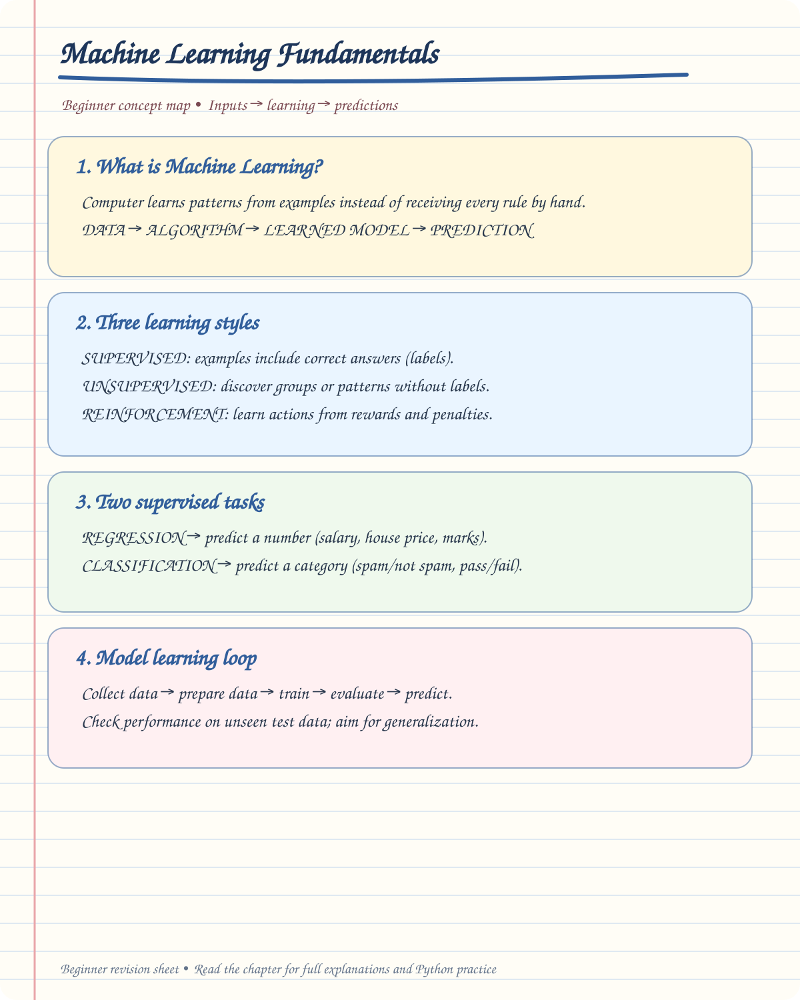

# 🤖 Machine Learning Fundamentals — Beginner Notes

> 🎯 **Goal:** Understand the basic Machine Learning concepts before learning individual ML algorithms.


## ✍️ Handwritten Beginner Notes

Use this visual summary to understand the main idea before moving into the detailed examples and code.

<div align="center">



[🖼️ Open the full-size handwritten notes](handwritten/machine-learning-fundamentals.svg)

</div>

---

# 📚 Table of Contents

1. [What is Machine Learning?](#1-what-is-machine-learning)
2. [Types of Machine Learning](#2-types-of-machine-learning)
3. [Supervised Learning](#3-supervised-learning)
4. [Regression](#4-regression)
5. [Classification](#5-classification)
6. [Regression vs Classification](#6-regression-vs-classification)
7. [Linear Regression](#7-linear-regression)
8. [Error / Residual](#8-error--residual)
9. [MAE](#9-mae)
10. [MSE](#10-mse)
11. [Gradient Descent](#11-gradient-descent)
12. [Partial Derivatives](#12-partial-derivatives)
13. [Updating Model Parameters](#13-updating-model-parameters)
14. [Optimization](#14-optimization)
15. [Overfitting](#15-overfitting)
16. [Underfitting](#16-underfitting)
17. [Generalization](#17-generalization)
18. [Logistic Regression](#18-logistic-regression)
19. [Sigmoid Function](#19-sigmoid-function)
20. [SVM](#20-svm)
21. [Unsupervised Learning](#21-unsupervised-learning)
22. [Clustering](#22-clustering)
23. [Dimensionality Reduction](#23-dimensionality-reduction)
24. [Important ML Algorithms](#24-important-ml-algorithms)
25. [Learning Flow](#25-learning-flow)

---

# 1. 🤖 What is Machine Learning?

Machine Learning is a field of Artificial Intelligence where a computer learns patterns from data and uses those patterns to make predictions or decisions.

### Simple idea

```text
Data
  ↓
Machine Learning Algorithm
  ↓
Learn Pattern
  ↓
Model
  ↓
Prediction
```

### Example

Suppose we have:

| Hours Studied | Marks |
|---:|---:|
| 2 | 40 |
| 4 | 55 |
| 6 | 70 |
| 8 | 85 |

The model learns the relationship between:

```text
Hours Studied → Marks
```

Then we can give:

```text
Hours = 10
```

and the model predicts the marks.

---

# 2. 🧠 Types of Machine Learning

Machine Learning can be broadly divided into:

```text
Machine Learning
│
├── Supervised Learning
│
├── Unsupervised Learning
│
└── Reinforcement Learning
```

---

## 2.1 🎯 Supervised Learning

In supervised learning, we have:

```text
Input Data + Known Output
```

The model learns from examples where the correct answer is already available.

### Example

```text
House Size → House Price
```

We already know the prices of previous houses.

### Main types

```text
Supervised Learning
│
├── Regression
│
└── Classification
```

---

## 2.2 🔍 Unsupervised Learning

In unsupervised learning, the data does **not have a known target/output**.

The model tries to discover patterns or groups in the data.

### Example

Customer data:

```text
Customer 1
Customer 2
Customer 3
Customer 4
...
```

The model can discover groups such as:

```text
Group 1 → High spending customers
Group 2 → Medium spending customers
Group 3 → Low spending customers
```

### Important techniques

- K-Means
- Hierarchical Clustering
- DBSCAN
- PCA

---

## 2.3 🎮 Reinforcement Learning

In Reinforcement Learning, an agent learns through:

```text
Reward
   +
Penalty
```

The agent tries to learn actions that produce better rewards.

### Example

```text
Game Agent
    ↓
Take Action
    ↓
Receive Reward / Penalty
    ↓
Learn
    ↓
Take Better Action
```

---

# 3. 🎯 Supervised Learning

Supervised Learning mainly contains:

```text
Supervised Learning
│
├── Regression
│
└── Classification
```

The main difference is the **type of target/output**.

---

# 4. 📈 Regression

Regression is used when the target/output is a:

> **Numerical / Continuous value**

### Examples

Predict:

- 💰 Salary
- 🏠 House Price
- 📦 Sales
- 🌡️ Temperature
- 🚗 Car Price

### Example

```text
Input:
Experience = 5 years

Output:
Salary = ₹8,00,000
```

The output is a number.

Therefore:

```text
Numerical / Continuous
          ↓
       Regression
```

---

# 5. 🏷️ Classification

Classification is used when the target/output belongs to a:

> **Class / Category**

### Examples

```text
Email → Spam / Not Spam
Customer → Churn / Not Churn
Disease → Yes / No
```

The output is a category.

```text
Binary / Categorical Value
          ↓
      Classification
```

### Binary Classification

Only two classes:

```text
Yes / No

0 / 1

Spam / Not Spam

Pass / Fail
```

### Multi-Class Classification

More than two classes:

```text
Cat
Dog
Horse
```

---

# 6. ⚖️ Regression vs Classification

| Feature | Regression | Classification |
|---|---|---|
| Output | Numerical | Category |
| Target | Continuous | Class |
| Example | House Price | Spam / Not Spam |
| Example | Salary | Disease / No Disease |
| Example | Sales | Customer Churn |
| Main goal | Predict a number | Predict a class |

### Easy memory trick

```text
NUMBER → REGRESSION 🔢

CATEGORY → CLASSIFICATION 🏷️
```

---

# 7. 📈 Linear Regression

Linear Regression is one of the most basic Machine Learning algorithms.

It is used to predict a numerical value.

### Basic equation

$$
\hat{y} = mx + c
$$

Where:

| Symbol | Meaning |
|---|---|
| $x$ | Input / Feature |
| $\hat{y}$ | Predicted output |
| $m$ | Slope |
| $c$ | Intercept |

---

## 7.1 📊 Understanding the Graph

A linear regression model tries to find the **best-fit line**.

```text
y
│
│             •
│          •
│       •
│    •
│  •
│________________ x
```

The line tries to represent the relationship between:

```text
X → Y
```

---

## 7.2 📐 Slope

The slope tells us how much the predicted value changes when $x$ changes.

In:

$$
\hat{y} = mx + c
$$

`m` represents the slope.

### Example

If:

$$
m = 2
$$

then increasing $x$ by 1 increases the predicted $y$ by approximately 2.

---

## 7.3 📍 Intercept

`c` is the intercept.

It represents the predicted value when:

$$
x = 0
$$

Example:

$$
\hat{y} = 2x + 5
$$

When:

$$
x = 0
$$

then:

$$
\hat{y} = 5
$$

Therefore:

```text
Intercept = 5
```

---

# 8. ❌ Error / Residual

The difference between the actual value and predicted value is called the:

> **Error / Residual**

Formula:

$$
e = y - \hat{y}
$$

Where:

- $y$ = Actual value
- $\hat{y}$ = Predicted value
- $e$ = Error

### Example

Actual:

$$
y = 100
$$

Predicted:

$$
\hat{y} = 90
$$

Then:

$$
e = 100 - 90
$$

$$
e = 10
$$

So the prediction error is:

```text
10
```

---

# 9. 📏 MAE — Mean Absolute Error

MAE stands for:

> **Mean Absolute Error**

Formula:

$$
MAE = \frac{1}{n}\sum_{i=1}^{n}|y_i-\hat{y}_i|
$$

### Meaning of terms

| Symbol | Meaning |
|---|---|
| $n$ | Number of observations |
| $y_i$ | Actual value |
| $\hat{y}_i$ | Predicted value |
| $|...|$ | Absolute value |
| $\sum$ | Sum |

### Simple idea

```text
Actual
   ↓
Prediction
   ↓
Calculate Error
   ↓
Take Absolute Value
   ↓
Average
   ↓
MAE
```

### Important

Lower MAE is generally better.

```text
MAE = 2  → Better
MAE = 10 → Worse
```

when comparing models on the same target and scale.

---

# 10. 📐 MSE — Mean Squared Error

MSE stands for:

> **Mean Squared Error**

Formula:

$$
MSE = \frac{1}{n}\sum_{i=1}^{n}(y_i-\hat{y}_i)^2
$$

The main difference between MAE and MSE is:

```text
MAE → Absolute Error

MSE → Squared Error
```

---

## 10.1 🔢 Example

Suppose:

```text
Actual     = 10
Prediction = 8
```

Error:

$$
10-8=2
$$

Squared error:

$$
2^2=4
$$

MSE calculates the average of these squared errors across all observations.

---

## 10.2 ⚠️ Why square the error?

Squaring makes larger errors much more important.

Example:

```text
Error = 2

2² = 4
```

but:

```text
Error = 10

10² = 100
```

Therefore, MSE strongly penalizes large errors.

---

# 11. ⛰️ Gradient Descent

Gradient Descent is an **optimization algorithm**.

Its purpose is to find parameter values that minimize the cost/loss function.

### Basic idea

Imagine a mountain:

```text
       ⛰️
      /  \
     /    \
    /      \
   /        \
  /    ↓     \
 /   Minimum  \
```

We want to move toward the:

> **Minimum point**

---

# 12. 📐 Partial Derivatives

For Linear Regression, suppose the cost function is:

$$
J(m,c)
=
\frac{1}{n}
\sum_{i=1}^{n}
\left(y_i-(mx_i+c)\right)^2
$$

Here:

- $J$ = Cost function
- $m$ = Slope
- $c$ = Intercept
- $x_i$ = Input value
- $y_i$ = Actual value
- $n$ = Number of observations

---

## 12.1 ∂ Derivative with respect to $m$

The partial derivative is:

$$
\frac{\partial J}{\partial m}
=
-\frac{2}{n}
\sum_{i=1}^{n}
x_i
\left[
y_i-(mx_i+c)
\right]
$$

This tells us how the cost changes when we change:

```text
m = slope
```

while considering the other parameter fixed.

---

## 12.2 ∂ Derivative with respect to $c$

The partial derivative is:

$$
\frac{\partial J}{\partial c}
=
-\frac{2}{n}
\sum_{i=1}^{n}
\left[
y_i-(mx_i+c)
\right]
$$

This tells us how the cost changes when we change:

```text
c = intercept
```

---

# 13. ⚙️ Updating Model Parameters

Gradient Descent updates `m` and `c`.

### Update slope

$$
m := m-\alpha\frac{\partial J}{\partial m}
$$

### Update intercept

$$
c := c-\alpha\frac{\partial J}{\partial c}
$$

Where:

```text
α = Learning Rate
```

---

## 13.1 🎚️ Learning Rate

The learning rate controls the size of each step.

```text
Small α
   ↓
Small steps
   ↓
Slow learning
```

```text
Large α
   ↓
Large steps
   ↓
May overshoot the minimum
```

So we need an appropriate learning rate.

---

# 14. 🎯 Optimization

Optimization means:

> Finding the parameter values that give the best result according to the chosen loss/cost function.

For Linear Regression:

```text
Find m and c
      ↓
Calculate prediction
      ↓
Calculate error
      ↓
Calculate cost
      ↓
Use Gradient Descent
      ↓
Update m and c
      ↓
Repeat
      ↓
Minimum Cost
```

---

# 15. 🚨 Overfitting

Overfitting happens when a model learns the training data **too closely**, including noise.

### Training performance

```text
Excellent ✅
```

### Test performance

```text
Poor ❌
```

The model has learned the training data but does not generalize well to unseen data.

### Simple idea

```text
Too Complex
     ↓
Learns Noise
     ↓
Overfitting
```

---

# 16. ⚠️ Underfitting

Underfitting happens when the model is too simple to capture the underlying pattern.

### Training performance

```text
Poor ❌
```

### Test performance

```text
Poor ❌
```

### Simple idea

```text
Too Simple
     ↓
Doesn't learn enough
     ↓
Underfitting
```

---

# 17. 🎯 Generalization

The goal of Machine Learning is not simply to memorize training data.

The goal is:

> **Generalization**

Generalization means the model performs well on **unseen data**.

### Good model

```text
Training Data
     ↓
Learn Pattern
     ↓
Unseen Data
     ↓
Good Prediction
```

---

# 18. 🟢 Logistic Regression

Despite the name **Regression**, Logistic Regression is commonly used for:

> **Classification**

Example:

```text
Email
 ↓
Spam / Not Spam
```

or:

```text
Customer
 ↓
Churn / Not Churn
```

---

# 19. 📈 Sigmoid Function

Logistic Regression commonly uses the sigmoid function.

$$
\sigma(z)=\frac{1}{1+e^{-z}}
$$

The output is between:

$$
0 \le \sigma(z) \le 1
$$

So the result can be interpreted as a probability.

### Example

```text
Sigmoid output = 0.90
```

This can be interpreted as:

```text
90% probability
```

depending on the classification setup.

---

## 19.1 🔢 Classification using Probability

A common decision rule is:

```text
Probability ≥ 0.5
       ↓
Class 1
```

```text
Probability < 0.5
       ↓
Class 0
```

Example:

```text
0.80 → Class 1
0.20 → Class 0
```

> The threshold can be changed depending on the problem.

---

# 20. 🟦 SVM — Support Vector Machine

SVM stands for:

> **Support Vector Machine**

SVM can be used for:

- Classification
- Regression

---

## 20.1 📏 Decision Boundary

SVM tries to find a boundary that separates classes.

```text
Class A       |       Class B
              |
              |
--------------|--------------
              |
              |
```

The boundary separates the classes.

---

## 20.2 📐 Margin

SVM tries to find a decision boundary with a large margin between the classes.

```text
Class A

  •   •
    •
      •
       |  ← Decision Boundary
      •
    •
  •   •

Class B
```

The points closest to the boundary are important.

---

## 20.3 ⭐ Support Vectors

Support vectors are the training observations closest to the decision boundary.

They strongly influence the position of the separating boundary.

---

## 20.4 🎚️ C Parameter

SVM has an important parameter:

```text
C
```

### Large C

```text
Large C
   ↓
Stronger penalty for training errors
   ↓
Tries harder to classify training points correctly
```

### Small C

```text
Small C
   ↓
Allows more training errors
   ↓
Stronger regularization
```

So:

```text
Large C → Less tolerance for errors

Small C → More tolerance for errors
```

---

# 21. 🔍 Unsupervised Learning

Unsupervised learning works with data where the target/output is not provided.

Main tasks shown in the notes:

```text
Unsupervised Learning
│
├── Clustering
│
└── Dimensionality Reduction
```

---

# 22. 🟣 Clustering

Clustering means:

> Grouping similar data points together.

### Example

Suppose we have customer data.

The algorithm may find:

```text
Cluster 1 → Customers with low spending

Cluster 2 → Customers with medium spending

Cluster 3 → Customers with high spending
```

No class labels were provided beforehand.

---

## 22.1 Important Clustering Algorithms

### K-Means

```text
K-Means
```

Groups data into a specified number of clusters.

### Hierarchical Clustering

Creates a hierarchy of clusters.

### DBSCAN

Groups points based on density and can identify noise.

---

# 23. 📉 Dimensionality Reduction

Dimensionality reduction means:

> Reducing the number of features while trying to preserve useful information.

### Example

Suppose a dataset has:

```text
100 Features
```

We may reduce it to:

```text
10 Components
```

This can make the data easier to visualize and sometimes easier to work with.

---

## 23.1 PCA

PCA stands for:

> **Principal Component Analysis**

PCA is a popular dimensionality-reduction technique.

```text
Many Features
      ↓
     PCA
      ↓
Fewer Components
```

---

# 24. 🧠 Important ML Algorithms

## 📈 Regression Algorithms

Used when the target is numerical/continuous.

```text
Simple Linear Regression
Multiple Linear Regression
Polynomial Regression
Support Vector Regression
Decision Tree Regression
Random Forest Regression
XGBoost Regression
```

Short forms:

| Short Form | Full Name |
|---|---|
| SLR | Simple Linear Regression |
| MLR | Multiple Linear Regression |
| PR | Polynomial Regression |
| SVR | Support Vector Regression |
| DTR | Decision Tree Regression |
| RFR | Random Forest Regression |
| XGBoost R | XGBoost Regression |

---

# 25. 🏷️ Classification Algorithms

Used when the target is categorical.

```text
Logistic Regression
SVM / SVC
Decision Tree Classifier
Random Forest Classifier
XGBoost Classifier
```

Short forms:

| Short Form | Full Name |
|---|---|
| LR | Logistic Regression |
| SVC | Support Vector Classifier |
| DTC | Decision Tree Classifier |
| RFC | Random Forest Classifier |
| XGBoost Class | XGBoost Classifier |

---

# 26. 🔄 Complete ML Flow

The concepts from the screenshots can be connected like this:

```text
                    MACHINE LEARNING
                           │
             ┌─────────────┴─────────────┐
             │                           │
        SUPERVISED                  UNSUPERVISED
             │                           │
       ┌─────┴─────┐               ┌─────┴─────┐
       │           │               │           │
  REGRESSION  CLASSIFICATION   CLUSTERING  REDUCE DIM
       │           │               │           │
       │           │               │           │
      SLR          LR           K-Means       PCA
      MLR          SVM          Hierarchical
      PR           DT           DBSCAN
      SVR          RF
      DTR          XGBoost
      RFR
      XGBoost
```

---

# 27. 🧩 Regression Learning Flow

```text
Numerical / Continuous Target
             ↓
         Regression
             ↓
     Linear Regression
             ↓
      y = mx + c
             ↓
        Prediction
             ↓
       Error / Residual
             ↓
       MAE / MSE
             ↓
       Cost Function
             ↓
      Gradient Descent
             ↓
      Update m and c
             ↓
        Optimization
             ↓
      Better Prediction
```

---

# 28. 🏷️ Classification Learning Flow

```text
Binary / Categorical Target
             ↓
        Classification
             ↓
    ┌────────┼─────────┐
    ↓        ↓         ↓
   LR       SVM       DT/RF
    ↓        ↓         ↓
Probability Boundary  Rules
    ↓        ↓         ↓
       Class Prediction
```

---

# 29. 🔍 Unsupervised Learning Flow

```text
No Target / No Labels
         ↓
 Unsupervised Learning
         ↓
 ┌───────┴─────────┐
 ↓                 ↓
Clustering     Reduce Dimensions
 ↓                 ↓
K-Means            PCA
Hierarchical
DBSCAN
```

---

# 30. 📝 Important Machine Learning Formulas

These formulas are used in the introductory regression and classification concepts covered in this chapter.

## 30.1 📈 Simple Linear Regression Equation

This equation predicts a numerical output using one input feature.

$$
\\hat{y}=mx+c
$$

- $\\hat{y}$ = Predicted output
- $x$ = Input feature
- $m$ = Slope (change in prediction for a one-unit increase in $x$)
- $c$ = Intercept (prediction when $x=0$)

## 30.2 ❌ Residual Error

Residual is the difference between the actual value and the predicted value.

$$
e=y-\\hat{y}
$$

- $e$ = Residual/error
- $y$ = Actual value
- $\\hat{y}$ = Predicted value

## 30.3 📏 Mean Absolute Error (MAE)

MAE calculates the average absolute difference between actual and predicted values.

$$
MAE=\\frac{1}{n}\\sum_{i=1}^{n}|y_i-\\hat{y}_i|
$$

A lower MAE indicates smaller average absolute prediction errors when comparing models on the same target scale.

## 30.4 📐 Mean Squared Error (MSE)

MSE calculates the average of the squared prediction errors.

$$
MSE=\\frac{1}{n}\\sum_{i=1}^{n}(y_i-\\hat{y}_i)^2
$$

Squaring gives larger errors more influence on the result.

## 30.5 🎯 Linear Regression Cost Function

This cost function measures the average squared error for the line defined by slope $m$ and intercept $c$.

$$
J(m,c)=\\frac{1}{n}\\sum_{i=1}^{n}\\left(y_i-(mx_i+c)\\right)^2
$$

The training objective is to find values of $m$ and $c$ that minimize this cost.

## 30.6 ⛰️ Gradient Descent — Slope Update

This rule updates the slope in the direction that reduces the cost.

$$
m:=m-\\alpha\\frac{\\partial J}{\\partial m}
$$

## 30.7 ⛰️ Gradient Descent — Intercept Update

This rule updates the intercept in the direction that reduces the cost.

$$
c:=c-\\alpha\\frac{\\partial J}{\\partial c}
$$

Here, $\\alpha$ is the learning rate, which controls the update step size.

## 30.8 🟢 Sigmoid Function

The sigmoid function maps a real-valued input to a value between 0 and 1. It is commonly used by Logistic Regression to produce a probability-like score for binary classification.

$$
\\sigma(z)=\\frac{1}{1+e^{-z}}
$$

> **Note:** Sigmoid is associated with Logistic Regression classification, not ordinary Simple Linear Regression.

## 30.9 🧮 Partial Derivative — Cost with Respect to Slope

For the cost function defined above, this derivative shows how the cost changes as the slope $m$ changes.

$$
\\frac{\\partial J}{\\partial m}
=-\\frac{2}{n}\\sum_{i=1}^{n}x_i\\left[y_i-(mx_i+c)\\right]
$$

## 30.10 🧮 Partial Derivative — Cost with Respect to Intercept

This derivative shows how the cost changes as the intercept $c$ changes.

$$
\\frac{\\partial J}{\\partial c}
=-\\frac{2}{n}\\sum_{i=1}^{n}\\left[y_i-(mx_i+c)\\right]
$$

# 31. 🎯 Most Important Concepts to Remember

### 1️⃣ Supervised Learning

```text
Known Target
     ↓
Learn from Examples
     ↓
Predict
```

### 2️⃣ Regression

```text
Numerical Output
```

### 3️⃣ Classification

```text
Categorical Output
```

### 4️⃣ Linear Regression

```text
ŷ = mx + c
```

### 5️⃣ Error

```text
Actual - Prediction
```

### 6️⃣ MAE

```text
Average Absolute Error
```

### 7️⃣ MSE

```text
Average Squared Error
```

### 8️⃣ Gradient Descent

```text
Optimization technique
```

### 9️⃣ Overfitting

```text
Too much learning from training data
```

### 🔟 Underfitting

```text
Too little learning
```

### 1️⃣1️⃣ Logistic Regression

```text
Classification
```

### 1️⃣2️⃣ SVM

```text
Boundary + Margin + Support Vectors
```

### 1️⃣3️⃣ K-Means

```text
Clustering
```

### 1️⃣4️⃣ PCA

```text
Dimensionality Reduction
```

---

# 🧪 Beginner Practice Questions

## Q1. What is Machine Learning?

**Answer:** Machine Learning is a field of AI where models learn patterns from data and use them to make predictions or decisions.

---

## Q2. What are the main types of Machine Learning?

**Answer:**

1. Supervised Learning
2. Unsupervised Learning
3. Reinforcement Learning

---

## Q3. What is the difference between Regression and Classification?

**Answer:**

Regression predicts a numerical value.

Classification predicts a category/class.

---

## Q4. Give an example of Regression.

**Answer:**

Predicting house price.

---

## Q5. Give an example of Classification.

**Answer:**

Predicting whether an email is spam or not spam.

---

## Q6. What is the formula of Linear Regression?

**Answer:**

$$
\hat{y}=mx+c
$$

---

## Q7. What is an error/residual?

**Answer:**

The difference between the actual value and predicted value.

$$
e=y-\hat{y}
$$

---

## Q8. What is MAE?

**Answer:**

MAE is Mean Absolute Error. It calculates the average absolute difference between actual and predicted values.

---

## Q9. What is MSE?

**Answer:**

MSE is Mean Squared Error. It calculates the average squared difference between actual and predicted values.

---

## Q10. What is Gradient Descent?

**Answer:**

Gradient Descent is an optimization technique used to minimize a cost/loss function by updating model parameters step by step.

---

## Q11. What is Overfitting?

**Answer:**

Overfitting happens when a model learns the training data too closely and performs poorly on unseen data.

---

## Q12. What is Underfitting?

**Answer:**

Underfitting happens when the model is too simple to learn the underlying pattern.

---

## Q13. Is Logistic Regression used for Regression or Classification?

**Answer:**

Logistic Regression is commonly used for **Classification**.

---

## Q14. What is SVM?

**Answer:**

SVM stands for Support Vector Machine. It can be used for classification and regression.

---

## Q15. What is K-Means?

**Answer:**

K-Means is an unsupervised clustering algorithm used to group similar data points.

---

## Q16. What is PCA?

**Answer:**

PCA stands for Principal Component Analysis. It is used for dimensionality reduction.

---

# 🗺️ Beginner Learning Roadmap

Follow this order:

```text
1. Machine Learning Basics
        ↓
2. Supervised vs Unsupervised
        ↓
3. Regression vs Classification
        ↓
4. Simple Linear Regression
        ↓
5. Error / Residual
        ↓
6. MAE
        ↓
7. MSE
        ↓
8. Cost Function
        ↓
9. Gradient Descent
        ↓
10. Partial Derivatives
        ↓
11. Optimization
        ↓
12. Underfitting / Overfitting
        ↓
13. Logistic Regression
        ↓
14. KNN
        ↓
15. Decision Tree
        ↓
16. Random Forest
        ↓
17. SVM
        ↓
18. Gradient Boosting
        ↓
19. K-Means
        ↓
20. PCA
        ↓
21. More Advanced ML
```

---

# 🎓 Final Revision

```text
                    MACHINE LEARNING
                           │
        ┌──────────────────┼──────────────────┐
        │                  │                  │
   SUPERVISED        UNSUPERVISED      REINFORCEMENT
        │                  │
   ┌────┴────┐        ┌────┴────┐
   │         │        │         │
REGRESSION CLASSIFICATION CLUSTERING REDUCTION
   │         │        │         │
  SLR        LR      K-Means     PCA
  MLR        SVM     Hierarchical
  PR         DT      DBSCAN
  SVR        RF
  DTR        XGBoost
  RFR
```

### ⭐ Core formulas

$$
\hat{y}=mx+c
$$

$$
e=y-\hat{y}
$$

$$
MAE=\frac{1}{n}\sum_{i=1}^{n}|y_i-\hat{y}_i|
$$

$$
MSE=\frac{1}{n}\sum_{i=1}^{n}(y_i-\hat{y}_i)^2
$$

$$
J(m,c)=
\frac{1}{n}
\sum_{i=1}^{n}
\left(y_i-(mx_i+c)\right)^2
$$

$$
m:=m-\alpha\frac{\partial J}{\partial m}
$$

$$
c:=c-\alpha\frac{\partial J}{\partial c}
$$

$$
\sigma(z)=\frac{1}{1+e^{-z}}
$$

---

# 🚀 Next Step

After understanding these fundamentals, start the algorithms one by one:

```text
01 → Simple Linear Regression
02 → Multiple Linear Regression
03 → Logistic Regression
04 → KNN
05 → Decision Tree
06 → Random Forest
07 → SVM
08 → Gradient Boosting
09 → K-Means
10 → PCA
11 → Hierarchical Clustering
12 → DBSCAN
13 → Anomaly Detection
```

> 💡 **Important:** Do not try to memorize all formulas immediately. First understand **what problem the algorithm solves, what the input/output is, how the algorithm works, and why the formula is needed.**

---

## ✅ Beginner Checklist

- [ ] Understand Machine Learning
- [ ] Understand Supervised Learning
- [ ] Understand Unsupervised Learning
- [ ] Understand Regression
- [ ] Understand Classification
- [ ] Understand Linear Regression
- [ ] Understand slope and intercept
- [ ] Understand error/residual
- [ ] Understand MAE
- [ ] Understand MSE
- [ ] Understand cost function
- [ ] Understand Gradient Descent
- [ ] Understand partial derivatives
- [ ] Understand learning rate
- [ ] Understand optimization
- [ ] Understand overfitting
- [ ] Understand underfitting
- [ ] Understand Logistic Regression
- [ ] Understand Sigmoid
- [ ] Understand SVM
- [ ] Understand Clustering
- [ ] Understand PCA
- [ ] Practice ML algorithms with Python

---

# 🏆 Golden Rule

```text
Understand the Concept
        ↓
Understand the Mathematics
        ↓
Draw the Graph
        ↓
Do a Manual Example
        ↓
Write Python Code
        ↓
Use Scikit-Learn
        ↓
Evaluate the Model
        ↓
Build a Real Project
        ↓
Prepare Interview Questions
```

**This is the foundation for your Machine Learning journey. 🚀**