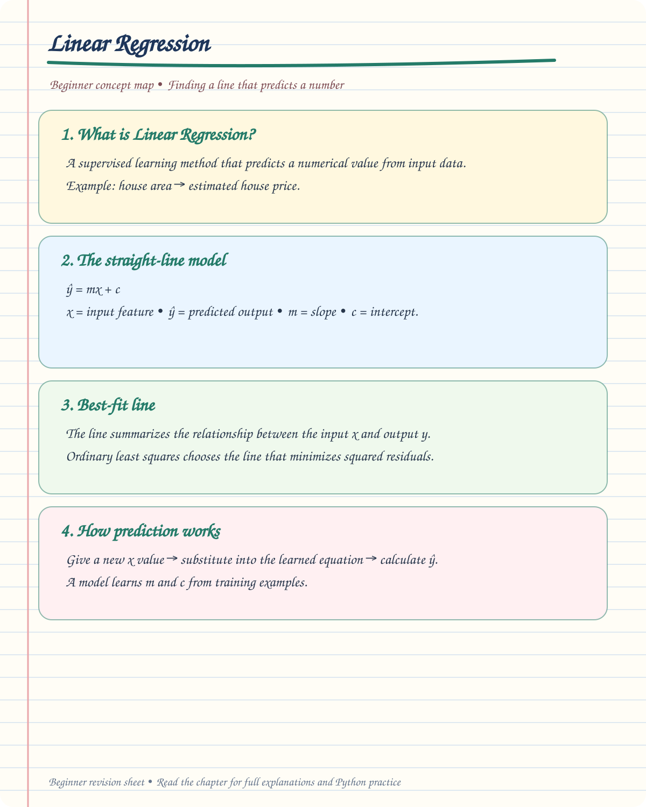

# 📈 Linear Regression — Beginner Notes

> 🎯 **Goal:** Understand how Linear Regression uses input data to predict a numerical value.

## ✍️ Handwritten Beginner Notes



[🖼️ Open the full-size Linear Regression notes](handwritten/linear-regression-basics.svg)

## 📚 Chapter contents

This folder includes:
- `2.png` — your existing study image
- `class1.py` and `class2.py` — class examples
- `RealTime_Example.py` — practical example
- `simpleLR.html` — visual / interactive example
- `handwritten/linear-regression-basics.svg` — beginner visual summary

## 🧠 What is Linear Regression?

Linear Regression is a supervised machine learning algorithm used to predict a numerical value from one or more input features.

Example:

```text
House Area  →  Linear Regression Model  →  Predicted House Price
```

## 📐 Straight-line equation

$$
\hat{y}=mx+c
$$

| Symbol | Meaning |
|---|---|
| $x$ | Input feature |
| $\hat{y}$ | Predicted output |
| $m$ | Slope |
| $c$ | Intercept |

## 📊 Best-fit line

The model learns a line that describes the relationship between the input and output. In ordinary least squares, it chooses the line that minimizes the sum of squared residuals.

## 🔍 How prediction works

1. Give the model training examples.
2. The model estimates the slope and intercept.
3. Provide a new input value.
4. Substitute that value into the learned equation to get a prediction.

> **Remember:** Regression predicts a number (for example, price, marks, or sales), while classification predicts a category.
