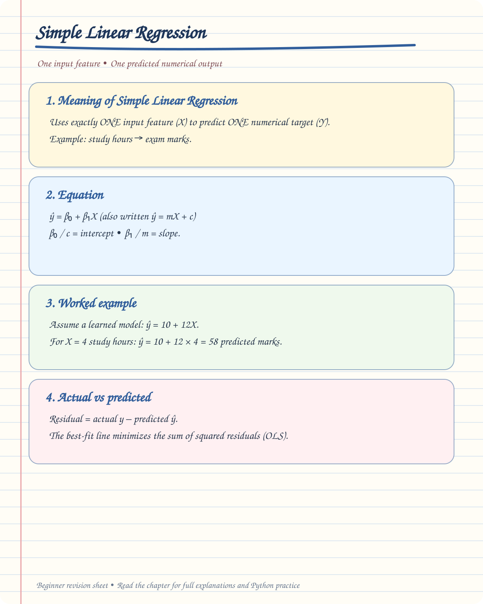

# 📈 Chapter — Simple Linear Regression

> **Goal:** Understand Simple Linear Regression from **zero level → mathematics → graph → error → Gradient Descent → Python → evaluation → interview questions**.


## ✍️ Handwritten Beginner Notes

Use this visual summary to understand the main idea before moving into the detailed examples and code.

<div align="center">



[🖼️ Open the full-size handwritten notes](handwritten/simple-linear-regression.svg)

</div>

---

# 🧠 1. What is Regression?

**Regression** is a Machine Learning technique used to predict a **numerical / continuous value**.

### Examples

| Input | Predicted Output |
|---|---|
| Experience | Salary |
| Area of house | House Price |
| Advertising Budget | Sales |
| Hours Studied | Exam Score |
| Temperature | Electricity Usage |

### Example

Suppose:

```text
Experience = 3 years
```

We want to predict:

```text
Salary = ₹6 LPA
```

Since salary is a numerical value, this is a **Regression problem**.

---

# 🎯 2. Where does Linear Regression fit?

```text
Machine Learning
│
├── Supervised Learning
│
│   ├── Regression
│   │   ├── Simple Linear Regression
│   │   ├── Multiple Linear Regression
│   │   ├── Polynomial Regression
│   │   ├── Decision Tree Regression
│   │   ├── Random Forest Regression
│   │   └── Gradient Boosting Regression
│   │
│   └── Classification
│       ├── Logistic Regression
│       ├── Decision Tree Classification
│       ├── Random Forest Classification
│       └── SVM Classification
│
└── Unsupervised Learning
    ├── Clustering
    └── Dimensionality Reduction
```

> ⚠️ **Important:** Logistic Regression is mainly used for **Classification**, despite having "Regression" in its name.

---

# 📌 3. What is Simple Linear Regression?

**Simple Linear Regression (SLR)** predicts a numerical target using **one input feature**.

### Simple example

We have:

```text
X = Years of Experience
Y = Salary
```

Our goal is to find the best line that represents the relationship between `X` and `Y`.

```text
Salary
  │
  │                  ●
  │             ●
  │          ●
  │       ●
  │    ●
  │ ●
  └──────────────────────── Experience
```

The model tries to find the **best-fit straight line**.

---

# 📐 4. Simple Linear Regression Equation

The basic equation is:

$$
\hat{y}=mx+b
$$

Where:

| Symbol | Meaning |
|---|---|
| $x$ | Input feature |
| $y$ | Actual value |
| $\hat{y}$ | Predicted value |
| $m$ | Slope |
| $b$ | Intercept |

---

# 🔍 5. Understanding the Equation

Suppose:

$$
\hat{y} = 2x + 3
$$

Here:

```text
m = 2
b = 3
```

If:

```text
x = 1
```

Then:

$$
\hat{y} = 2(1) + 3
$$

$$
\hat{y} = 5
$$

If:

```text
x = 2
```

Then:

$$
\hat{y} = 2(2) + 3
$$

$$
\hat{y} = 7
$$

If:

```text
x = 3
```

Then:

$$
\hat{y} = 2(3) + 3
$$

$$
\hat{y} = 9
$$

So:

| x | Predicted $\hat{y}$ |
|---:|---:|
| 1 | 5 |
| 2 | 7 |
| 3 | 9 |

---

# 📈 6. What is Slope?

The **slope ($m$)** tells us how much the predicted output changes when the input increases by 1 unit.

$$
\hat{y}=mx+b
$$

Suppose:

$$
\hat{y}=2x+3
$$

Here:

```text
m = 2
```

Therefore:

> For every 1-unit increase in `x`, predicted `y` increases by 2 units.

### Example

If experience increases from:

```text
2 years → 3 years
```

and:

```text
m = 2
```

the predicted salary value increases by 2 units in whatever units `y` uses.

---

# 📍 7. What is Intercept?

The **intercept ($b$)** is the predicted value of `y` when `x = 0`.

$$
\hat{y}=mx+b
$$

If:

```text
m = 2
b = 3
```

Then when:

```text
x = 0
```

$$
\hat{y}=2(0)+3
$$

$$
\hat{y}=3
$$

Therefore:

```text
Intercept = 3
```

---

# 📊 8. Actual Value vs Predicted Value

Suppose our dataset contains:

| Experience | Actual Salary |
|---:|---:|
| 1 | 4 |
| 2 | 6 |
| 3 | 8 |
| 4 | 10 |

Our model predicts:

| Experience | Actual $y$ | Predicted $\hat{y}$ |
|---:|---:|---:|
| 1 | 4 | 4.2 |
| 2 | 6 | 5.8 |
| 3 | 8 | 7.7 |
| 4 | 10 | 10.1 |

The difference between actual and predicted values is called **error / residual**.

---

# ❌ 9. What is Error?

The basic error formula is:

$$
e = y-\hat{y}
$$

Where:

```text
y      = Actual value
ŷ      = Predicted value
e      = Error / Residual
```

### Example

Actual:

$$
y=10
$$

Predicted:

$$
\hat{y}=8
$$

Therefore:

$$
e=10-8
$$

$$
e=2
$$

So the prediction is off by **2 units**.

---

# 📏 10. Residual

A **residual** is the vertical difference between the actual data point and the predicted line.

```text
Actual point ●
             │
             │  ← Residual
             │
Predicted  ──●──────────── Regression Line
```

Mathematically:

$$
Residual = y-\hat{y}
$$

A good model tries to keep the residuals small.

---

# 🎯 11. What is the Best-Fit Line?

There can be many possible lines through a dataset.

```text
Line 1  ─────────────
Line 2       ╱
Line 3     ╱
Line 4   ╱
```

But we want the line that produces the **smallest overall prediction error**.

This is called the:

> **Best-Fit Line**

For ordinary least-squares linear regression, we choose the line that minimizes the **sum of squared residuals**.

---

# 📉 12. Mean Absolute Error — MAE

MAE means:

> **Mean Absolute Error**

Formula:

$$
MAE=
\frac{1}{n}
\sum_{i=1}^{n}
|y_i-\hat{y}_i|
$$

### Meaning of each term

| Term | Meaning |
|---|---|
| $n$ | Number of observations |
| $y_i$ | Actual value |
| $\hat{y}_i$ | Predicted value |
| $y_i-\hat{y}_i$ | Error |
| $|...|$ | Absolute value |
| $\sum$ | Add all errors |
| $\frac{1}{n}$ | Take the average |

---

# 🧮 13. MAE Example

Suppose:

```text
Actual    = [10, 20, 30]
Predicted = [12, 18, 33]
```

Errors:

$$
10-12=-2
$$

$$
20-18=2
$$

$$
30-33=-3
$$

Absolute errors:

```text
2, 2, 3
```

Therefore:

$$
MAE=\frac{2+2+3}{3}
$$

$$
MAE=\frac{7}{3}
$$

$$
MAE\approx2.33
$$

### Interpretation

The model's predictions are off by about:

```text
2.33 units on average
```

---

# 📉 14. Mean Squared Error — MSE

MSE means:

> **Mean Squared Error**

Formula:

$$
MSE=
\frac{1}{n}
\sum_{i=1}^{n}
(y_i-\hat{y}_i)^2
$$

Unlike MAE, MSE **squares the errors**.

---

# 🧮 15. MSE Example

Using:

```text
Actual    = [10, 20, 30]
Predicted = [12, 18, 33]
```

Errors:

```text
-2, 2, -3
```

Squared errors:

```text
4, 4, 9
```

Therefore:

$$
MSE=\frac{4+4+9}{3}
$$

$$
MSE=\frac{17}{3}
$$

$$
MSE\approx5.67
$$

---

# ⚖️ 16. MAE vs MSE

| MAE | MSE |
|---|---|
| Uses absolute error | Uses squared error |
| Easier to interpret | Penalizes large errors more |
| Less sensitive to outliers | More sensitive to outliers |
| Same unit as target | Squared unit |

### Simple memory trick

```text
MAE → Absolute

MSE → Square
```

---

# 🧠 17. Why do we need a Cost Function?

The model needs a way to answer:

> **"How bad are my predictions?"**

The cost/loss function gives us a numerical measure of error.

For linear regression, a common objective is based on squared error.

$$
J(m,b)=
\frac{1}{n}
\sum_{i=1}^{n}
\left(y_i-(mx_i+b)\right)^2
$$

The goal is:

$$
\text{Minimize } J(m,b)
$$

In simple words:

> Find values of `m` and `b` that make the prediction error as small as possible.

---

# 🏔️ 18. Cost Function Visualization

Think of the cost function like a mountain/valley.

```text
Cost
 │
 │\
 │ \
 │  \
 │   \        /
 │    \______/   ← Minimum
 │
 └──────────────── Parameter
```

The lowest point represents a parameter combination with low cost.

The optimization process tries to move toward this minimum.

---

# 🚶 19. Gradient Descent

**Gradient Descent** is an optimization algorithm used to find parameter values that minimize a cost function.

For Linear Regression, the parameters are:

```text
m → slope
b → intercept
```

The basic idea:

```text
Start somewhere
      ↓
Calculate cost
      ↓
Calculate gradient
      ↓
Move toward lower cost
      ↓
Repeat
      ↓
Reach minimum
```

---

# 📐 20. Cost Function for Gradient Descent

For Simple Linear Regression:

$$
J(m,b)=
\frac{1}{n}
\sum_{i=1}^{n}
\left[y_i-(mx_i+b)\right]^2
$$

We calculate how the cost changes with respect to:

```text
m
```

and:

```text
b
```

These are called **partial derivatives**.

---

# 🧮 21. Partial Derivative with Respect to m

The derivative is:

$$
\frac{\partial J}{\partial m}
=
-\frac{2}{n}
\sum_{i=1}^{n}
x_i
\left[
y_i-(mx_i+b)
\right]
$$

### Meaning

This tells us:

> How much the cost function changes when we change the slope `m`.

---

## 🧮 22. Partial Derivative with Respect to b

The partial derivative tells us how the cost function changes when the intercept $b$ changes, while keeping the slope $m$ fixed.

### Formula

### Formula

$
\frac{\partial J}{\partial b}
=
-\frac{2}{n}\sum_{i=1}^{n}
\left[y_i-(mx_i+b)\right]
$

### Explanation

- $\frac{\partial J}{\partial b}$ — How the cost changes when $b$ changes.
- $J$ — Cost function, which measures prediction error.
- $n$ — Total number of data points.
- $y_i$ — Actual value for data point $i$.
- $mx_i+b$ — Predicted value for data point $i$.
- $\sum$ — Add the values across all data points.

**In simple words:** This formula helps determine how to adjust the intercept $b$ to reduce prediction errors during Gradient Descent.


### Meaning

This tells us:

> How much the cost function changes when we change the intercept `b`.

---

# 🔄 23. Updating m and b

Once we calculate the gradients, we update the parameters.

### Update slope

$$
m :=
m-\alpha
\frac{\partial J}{\partial m}
$$

### Update intercept

$$
b :=
b-\alpha
\frac{\partial J}{\partial b}
$$

Where:

```text
α = Learning Rate
```

---

# 🚦 24. What is Learning Rate?

The **learning rate ($\alpha$)** controls how big a step Gradient Descent takes.

```text
Small learning rate
→ Small steps
→ Slow learning

Large learning rate
→ Large steps
→ May overshoot the minimum
```

### Example

```text
α = 0.001  → very small step

α = 0.01   → moderate step

α = 0.1    → larger step
```

The correct learning rate helps the algorithm converge efficiently.

---

# 🧠 25. Gradient Descent Intuition

Imagine standing on a hill.

Your goal is to reach the lowest point.

```text
        ● Start
       /
      /
     /
    /      ↓
   /       ↓
  /         ↓
 /___________●
             Minimum
```

Gradient Descent repeatedly asks:

> "Which direction takes me downhill?"

Then it takes a small step in that direction.

---

# 🔁 26. Gradient Descent Algorithm

```text
1. Initialize m and b
        ↓
2. Calculate predictions
        ↓
3. Calculate cost
        ↓
4. Calculate gradients
        ↓
5. Update m
        ↓
6. Update b
        ↓
7. Repeat
        ↓
8. Cost becomes smaller
        ↓
9. Stop when convergence is reached
```

---

# 🎯 27. What is Convergence?

**Convergence** means the algorithm has reached a point where further updates produce very little improvement.

For example:

```text
Cost

100
 ↓
60
 ↓
30
 ↓
15
 ↓
8
 ↓
5
 ↓
4.9
 ↓
4.89
 ↓
4.889
```

The cost is barely changing.

The algorithm has approximately converged.

---

# 🧪 28. Manual Example

Consider:

| x | y |
|---:|---:|
| 1 | 2 |
| 2 | 4 |
| 3 | 6 |

We can see that:

```text
y = 2x
```

So the ideal parameters are approximately:

```text
m = 2
b = 0
```

Therefore:

$$
\hat{y}=2x+0
$$

Predictions:

| x | Actual y | Predicted $\hat{y}$ |
|---:|---:|---:|
| 1 | 2 | 2 |
| 2 | 4 | 4 |
| 3 | 6 | 6 |

Errors:

```text
0, 0, 0
```

Therefore:

$$
MAE=0
$$

and:

$$
MSE=0
$$

This is a perfect fit for this simple dataset.

---

# 📊 29. Linear Regression Graph

A typical Linear Regression graph contains:

```text
Y
│
│              ●
│           ●
│        ●
│      ●
│   ●
│ ●
│
└──────────────────── X
```

The model tries to find a straight line that represents the relationship between `X` and `Y`.

---

# 📌 30. What if the points don't lie exactly on the line?

Real-world data usually contains noise.

```text
Y
│
│             ●
│          ●
│       ●
│     ●
│        ●
│  ●
│
└──────────────────── X
```

The line does not need to pass through every point.

Instead, it should provide a good overall fit.

---

# ⚠️ 31. Underfitting

Underfitting occurs when the model is **too simple** to capture the important pattern in the data.

```text
Actual pattern:

      ╭────╮
    ╭─╯    ╰─╮
───╯          ╰───

Model:

──────────────
```

### Characteristics

```text
Training performance → Poor
Testing performance  → Poor
```

### Solution

```text
Increase model complexity
Add useful features
Use a more suitable algorithm
Reduce excessive regularization
```

---

# ⚠️ 32. Overfitting

Overfitting occurs when a model learns the training data **too closely**, including noise.

```text
Data:

●   ●
  ●   ●
    ●
       ●

Overly complex model:

╭─╮╭─╮
╯ ╰╯ ╰──
```

### Characteristics

```text
Training performance → Very good
Testing performance  → Poor
```

The model does not generalize well to unseen data.

---

# 🎯 33. Good Fit

A good model learns the important underlying relationship without memorizing noise.

```text
Training data
      ↓
Learn useful pattern
      ↓
Generalize
      ↓
Good performance on unseen data
```

### Main goal

> **Generalization**

---

# 📊 34. Underfitting vs Good Fit vs Overfitting

| Underfitting | Good Fit | Overfitting |
|---|---|---|
| Too simple | Appropriate complexity | Too complex |
| High bias | Balanced | High variance |
| Poor train performance | Good train performance | Excellent train performance |
| Poor test performance | Good test performance | Poor test performance |

---

# 🧠 35. Important Terms

### Feature

Input variable used by the model.

Example:

```text
Experience
```

### Target

The value we want to predict.

Example:

```text
Salary
```

### Prediction

Value produced by the model.

$$
\hat{y}
$$

### Residual

Difference between actual and predicted value.

$$
e=y-\hat{y}
$$

### Parameter

A value learned by the model.

For SLR:

```text
m = slope
b = intercept
```

### Learning Rate

Controls the step size during Gradient Descent.

$$
\alpha
$$

---

# 🐍 36. Simple Linear Regression in Python

## Step 1 — Import Libraries

```python
import numpy as np
import matplotlib.pyplot as plt

from sklearn.linear_model import LinearRegression
```

---

## Step 2 — Create Data

```python
X = np.array([1, 2, 3, 4, 5]).reshape(-1, 1)

y = np.array([2, 4, 6, 8, 10])
```

Here:

```text
X → Input feature
y → Target
```

---

## Step 3 — Create Model

```python
model = LinearRegression()
```

---

## Step 4 — Train Model

```python
model.fit(X, y)
```

The model learns:

```text
slope
intercept
```

---

## Step 5 — Check Coefficients

```python
print("Slope:", model.coef_[0])
print("Intercept:", model.intercept_)
```

Expected approximately:

```text
Slope: 2
Intercept: 0
```

---

# 🔮 37. Make a Prediction

Suppose:

```text
x = 6
```

We can predict:

```python
prediction = model.predict([[6]])

print(prediction)
```

Expected:

```text
[12.]
```

Because:

$$
y=2(6)+0
$$

$$
y=12
$$

---

# 📈 38. Visualize the Regression Line

```python
plt.scatter(X, y)

plt.plot(X, model.predict(X))

plt.xlabel("X")
plt.ylabel("Y")

plt.title("Simple Linear Regression")

plt.show()
```

The graph shows:

```text
●  Actual data points

──── Regression line
```

---

# 🧪 39. Complete Python Example

```python
import numpy as np
import matplotlib.pyplot as plt

from sklearn.linear_model import LinearRegression


# -------------------------
# 1. Create dataset
# -------------------------

X = np.array([1, 2, 3, 4, 5]).reshape(-1, 1)

y = np.array([2, 4, 6, 8, 10])


# -------------------------
# 2. Create model
# -------------------------

model = LinearRegression()


# -------------------------
# 3. Train model
# -------------------------

model.fit(X, y)


# -------------------------
# 4. Get parameters
# -------------------------

print("Slope:", model.coef_[0])

print("Intercept:", model.intercept_)


# -------------------------
# 5. Prediction
# -------------------------

prediction = model.predict([[6]])

print("Prediction:", prediction[0])


# -------------------------
# 6. Visualization
# -------------------------

plt.scatter(X, y)

plt.plot(X, model.predict(X))

plt.xlabel("X")

plt.ylabel("Y")

plt.title("Simple Linear Regression")

plt.show()
```

---

# 📏 40. Model Evaluation

For regression, commonly used metrics include:

```text
MAE
MSE
RMSE
R²
```

---

## MAE

$$
MAE=
\frac{1}{n}
\sum_{i=1}^{n}
|y_i-\hat{y}_i|
$$

Lower is better.

---

## MSE

$$
MSE=
\frac{1}{n}
\sum_{i=1}^{n}
(y_i-\hat{y}_i)^2
$$

Lower is better.

---

## RMSE

$$
RMSE=\sqrt{MSE}
$$

Lower is better.

---

## R² Score

R² measures how much of the variation in the target is explained by the model.

$$
R^2=
1-
\frac{SS_{res}}{SS_{tot}}
$$

A value closer to `1` generally indicates a better fit.

---

# 🧪 41. Evaluation in Python

```python
from sklearn.metrics import (
    mean_absolute_error,
    mean_squared_error,
    r2_score
)

y_pred = model.predict(X)

mae = mean_absolute_error(y, y_pred)

mse = mean_squared_error(y, y_pred)

rmse = np.sqrt(mse)

r2 = r2_score(y, y_pred)

print("MAE :", mae)

print("MSE :", mse)

print("RMSE:", rmse)

print("R²  :", r2)
```

---

# 🧠 42. Important Difference: MAE vs MSE

Suppose we have two errors:

```text
Error 1 = 2
Error 2 = 10
```

MAE treats them approximately as:

```text
2
10
```

MSE treats them as:

```text
4
100
```

Therefore:

> MSE gives much more importance to large errors.

---

# 🔥 43. Simple Linear Regression vs Multiple Linear Regression

### Simple Linear Regression

Uses **one feature**.

$$
\hat{y}=mx+b
$$

Example:

```text
Experience → Salary
```

### Multiple Linear Regression

Uses **multiple features** to predict one numerical target.

**Formula**

$
\hat{y} = \beta_0 + \beta_1x_1 + \beta_2x_2 + \cdots + \beta_px_p
$

**Meaning of each symbol**

| Symbol | Meaning |
|---|---|
| $\hat{y}$ | Predicted output |
| $\beta_0$ | Intercept |
| $\beta_1, \beta_2, \ldots, \beta_p$ | Coefficients (weights) learned for each feature |
| $x_1, x_2, \ldots, x_p$ | Input features |
| $p$ | Total number of input features |

**Example:** A house price model may use area, number of bedrooms, and age of the property as multiple input features.

Example:

```text
Experience
Education
Location
Skills
      ↓
    Salary
```

---

# ⚠️ 44. Important Correction

Do not confuse:

```text
Linear Regression
```

with:

```text
Logistic Regression
```

### Linear Regression

Used mainly for:

```text
Continuous numerical prediction
```

Example:

```text
Salary = ₹8.5 LPA
House Price = ₹75 lakh
```

### Logistic Regression

Used mainly for:

```text
Classification
```

Example:

```text
Spam / Not Spam
Yes / No
0 / 1
```

It uses the **sigmoid function**:

$$
\sigma(z)=
\frac{1}{1+e^{-z}}
$$

The output is between:

$$
0 \le \sigma(z) \le 1
$$

---

# 🧭 45. Complete Learning Flow

```text
Machine Learning
       ↓
Supervised Learning
       ↓
Regression
       ↓
Simple Linear Regression
       ↓
y = mx + b
       ↓
Prediction
       ↓
Residual / Error
       ↓
MAE / MSE
       ↓
Cost Function
       ↓
Gradient Descent
       ↓
Partial Derivatives
       ↓
Update m and b
       ↓
Minimize Cost
       ↓
Best-Fit Model
       ↓
Evaluate Model
       ↓
Generalize to New Data
```

---

# 🎯 46. What You Must Understand

Before moving to Multiple Linear Regression, make sure you understand:

- [ ] What is Regression?
- [ ] What is Simple Linear Regression?
- [ ] What is `X`?
- [ ] What is `y`?
- [ ] What is predicted $\hat{y}$?
- [ ] What is slope `m`?
- [ ] What is intercept `b`?
- [ ] What is a residual?
- [ ] What is MAE?
- [ ] What is MSE?
- [ ] What is a cost function?
- [ ] Why do we minimize cost?
- [ ] What is Gradient Descent?
- [ ] What is a partial derivative?
- [ ] What is learning rate?
- [ ] What is convergence?
- [ ] What is underfitting?
- [ ] What is overfitting?
- [ ] What is generalization?
- [ ] How to train Linear Regression using Scikit-learn?
- [ ] How to evaluate a regression model?

---

# 🎤 47. Interview Questions

### Q1. What is Linear Regression?

Linear Regression is a supervised learning algorithm used to predict a continuous numerical target by learning a linear relationship between input features and the target.

---

### Q2. What is Simple Linear Regression?

Simple Linear Regression uses **one independent variable** to predict a continuous dependent variable.

$$
\hat{y}=mx+b
$$

---

### Q3. What does the slope represent?

The slope represents how much the predicted target changes for a one-unit change in the input feature.

---

### Q4. What does the intercept represent?

The intercept is the predicted value of the target when the input feature is zero.

---

### Q5. What is a residual?

A residual is the difference between the actual value and predicted value.

$$
e=y-\hat{y}
$$

---

### Q6. What is MAE?

MAE is the average absolute difference between actual and predicted values.

$$
MAE=
\frac{1}{n}
\sum|y_i-\hat{y}_i|
$$

---

### Q7. What is MSE?

MSE is the average squared difference between actual and predicted values.

$$
MSE=
\frac{1}{n}
\sum(y_i-\hat{y}_i)^2
$$

---

### Q8. Why does MSE penalize large errors?

Because the errors are squared.

For example:

$$
2^2=4
$$

but:

$$
10^2=100
$$

Therefore, large errors contribute much more to MSE.

---

### Q9. What is Gradient Descent?

Gradient Descent is an optimization algorithm that iteratively updates model parameters in the direction that reduces the cost function.

---

### Q10. What is the learning rate?

The learning rate controls the size of each update made during Gradient Descent.

---

### Q11. What happens if the learning rate is too large?

The algorithm may overshoot the minimum and fail to converge properly.

---

### Q12. What happens if the learning rate is too small?

Training may become very slow because the algorithm takes very small steps.

---

### Q13. What is overfitting?

Overfitting occurs when a model learns the training data and its noise too closely, resulting in poor performance on unseen data.

---

### Q14. What is underfitting?

Underfitting occurs when the model is too simple to capture the underlying pattern in the data.

---

### Q15. What is the main goal of Machine Learning?

The main goal is not simply to memorize training data.

The goal is:

> **Learn useful patterns and generalize well to unseen data.**

---

# 🏆 48. Final Revision

Remember these five things first:

```text
1️⃣ Regression
   ↓
   Predict numerical values

2️⃣ Linear Equation
   ↓
   ŷ = mx + b

3️⃣ Error
   ↓
   e = y - ŷ

4️⃣ Cost
   ↓
   Measure prediction error

5️⃣ Gradient Descent
   ↓
   Minimize the cost
```

### ⭐ Core Formulas — Beginner-Friendly Revision

Use this section to revise the most important formulas. Read the meaning of each symbol before trying to memorize the equation.

#### 1. 📈 Simple Linear Regression Equation

This equation is used to **predict a numerical value from one input feature**.

$$
\hat{y}=mx+b
$$

**Meaning of each symbol**

| Symbol | Meaning |
|---|---|
| $x$ | Input value (feature), such as years of experience |
| $\hat{y}$ | Predicted output, such as predicted salary |
| $m$ | Slope: how much the prediction changes when $x$ increases by 1 |
| $b$ | Intercept: the predicted output when $x=0$ |

**Example**

Suppose the model is:

$$
\hat{y}=2x+3
$$

For an input of $x=4$:

$$
\hat{y}=2(4)+3=11
$$

So the model predicts **11**.

#### 2. ❌ Residual / Prediction Error

A residual tells us the difference between the actual value and the value predicted by the model.

$$
e=y-\hat{y}
$$

- $y$ = Actual value
- $\hat{y}$ = Predicted value
- $e$ = Residual (error)

**Example**

Actual value is 15 and predicted value is 12:

$$
e=15-12=3
$$

The model underpredicted by 3 units. A negative residual means the prediction was greater than the actual value.

#### 3. 📏 Mean Absolute Error (MAE)

MAE measures the **average size of the prediction errors**, ignoring whether an error is positive or negative.

$$
MAE=\frac{1}{n}\sum_{i=1}^{n}|y_i-\hat{y}_i|
$$

| Symbol | Meaning |
|---|---|
| $n$ | Total number of observations |
| $y_i$ | Actual value for observation $i$ |
| $\hat{y}_i$ | Predicted value for observation $i$ |
| $|\ |$ | Absolute value: make the error non-negative |
| $\sum$ | Add the values |

**Example**

Actual values: $[10,20,30]$

Predictions: $[12,18,33]$

Absolute errors are $[2,2,3]$:

$$
MAE=\frac{2+2+3}{3}=\frac{7}{3}\approx2.33
$$

On average, predictions are about **2.33 units away** from the actual values.

#### 4. 📐 Mean Squared Error (MSE)

MSE measures the **average of the squared prediction errors**. Squaring makes large errors count more heavily.

$$
MSE=\frac{1}{n}\sum_{i=1}^{n}(y_i-\hat{y}_i)^2
$$

**Example**

Using the same errors $[-2,2,-3]$, the squared errors are $[4,4,9]$:

$$
MSE=\frac{4+4+9}{3}=\frac{17}{3}\approx5.67
$$

A lower MSE is generally better when comparing models on the same target scale and dataset.

#### 5. 🎯 Linear Regression Cost Function

The cost function gives one score for the model's overall squared prediction error. During training, we try to find the slope $m$ and intercept $b$ that make this score small.

$$
J(m,b)=\frac{1}{n}\sum_{i=1}^{n}\left[y_i-(mx_i+b)\right]^2
$$

- $J(m,b)$ = Cost for the current choices of $m$ and $b$
- $x_i$ = Input for observation $i$
- $y_i$ = Actual output for observation $i$
- $mx_i+b$ = Model's prediction for observation $i$
- $n$ = Number of observations

**Remember:** The expression inside the square brackets is the residual. We square each residual and average them.

#### 6. 🧭 Partial Derivative with Respect to Slope ($m$)

This formula measures how the cost changes when we change the slope $m$, while keeping the intercept $b$ fixed.

$$
\frac{\partial J}{\partial m}
=-\frac{2}{n}\sum_{i=1}^{n}x_i\left[y_i-(mx_i+b)\right]
$$

- A partial derivative is the **sensitivity of the cost** to one parameter.
- The factor $x_i$ appears because changing the slope has a larger effect for larger input values.

#### 7. 🧭 Partial Derivative with Respect to Intercept ($b$)

This formula measures how the cost changes when we change the intercept $b$, while keeping the slope $m$ fixed.

$$
\frac{\partial J}{\partial b}
=-\frac{2}{n}\sum_{i=1}^{n}\left[y_i-(mx_i+b)\right]
$$

The derivative helps us determine how the intercept should be adjusted to reduce the cost.

#### 8. ⛰️ Gradient Descent — Slope Update

This rule updates the slope using its partial derivative.

$$
m_{new}=m_{old}-\alpha\frac{\partial J}{\partial m}
$$

#### 9. ⛰️ Gradient Descent — Intercept Update

This rule updates the intercept using its partial derivative.

$$
b_{new}=b_{old}-\alpha\frac{\partial J}{\partial b}
$$

**What is $\alpha$ (learning rate)?**

It controls the size of each update:
- Very small learning rate: learning can be slow.
- Very large learning rate: updates may jump past the minimum.
- A suitable learning rate helps the cost decrease steadily.

#### 10. 📉 Root Mean Squared Error (RMSE)

RMSE is the square root of MSE. It expresses the typical error scale in the **same units as the target**.

$$
RMSE=\sqrt{MSE}
$$

#### 11. 📊 R-Squared ($R^2$)

R-squared compares the model's squared prediction errors with the variation in the actual target values around their mean.

$$
R^2=1-\frac{SS_{res}}{SS_{tot}}
$$

Where:

$$
SS_{res}=\sum_{i=1}^{n}(y_i-\hat{y}_i)^2
$$

$$
SS_{tot}=\sum_{i=1}^{n}(y_i-\bar{y})^2
$$

- $SS_{res}$ = Sum of squared residuals (unexplained error)
- $SS_{tot}$ = Total sum of squares (variation around the actual-value mean)
- $\bar{y}$ = Mean of the actual target values

For the usual test-set interpretation, $R^2=1$ is a perfect prediction, $R^2=0$ is no better than predicting the mean, and $R^2$ can be negative when the model performs worse than that baseline.

#### 12. 🧮 Adjusted R-Squared

Adjusted R-squared modifies $R^2$ to account for how many input features are used. It is mainly used when comparing regression models with different numbers of predictors.

$$
R^2_{adj}=1-\frac{(1-R^2)(n-1)}{n-k-1}
$$

- $n$ = Number of observations
- $k$ = Number of independent variables (features)
- $R^2$ = R-squared score

Adding a feature does not always improve adjusted $R^2$; an unnecessary feature can make it decrease.

#### 13. 🔗 Multiple Linear Regression Equation — Preview

This is the extension of simple linear regression when we use more than one input feature.

$$
\hat{y}=b_0+b_1x_1+b_2x_2+\cdots+b_kx_k
$$

Simple Linear Regression uses one feature; Multiple Linear Regression uses two or more features.

#### 14. 🟢 Sigmoid Function — Classification Preview

The sigmoid function maps a number to a value between 0 and 1. It is commonly used in Logistic Regression for classification, **not** as the prediction equation for ordinary Simple Linear Regression.

$$
\sigma(z)=\frac{1}{1+e^{-z}}
$$

**Quick reminder:** Linear Regression predicts a numerical value. Logistic Regression uses the sigmoid function to produce a probability-like score for classification.


---

# 🚀 Next Chapter

After Simple Linear Regression, continue in this order:

```text
Chapter 1 → Simple Linear Regression       ✅
Chapter 2 → Multiple Linear Regression
Chapter 3 → Loss Functions
             ├── MAE
             ├── MSE
             └── RMSE
Chapter 4 → Gradient Descent
Chapter 5 → Underfitting & Overfitting
Chapter 6 → Train/Test Split
Chapter 7 → Model Evaluation
Chapter 8 → Logistic Regression
Chapter 9 → KNN
Chapter 10 → Decision Tree
Chapter 11 → Random Forest
Chapter 12 → SVM
Chapter 13 → K-Means
Chapter 14 → PCA
Chapter 15 → Gradient Boosting / XGBoost
```

> 🎯 **Do not rush to the algorithms. First make sure the Linear Regression foundation is strong.**